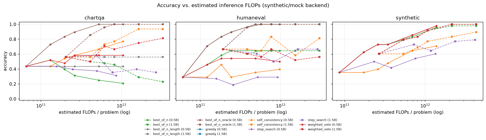
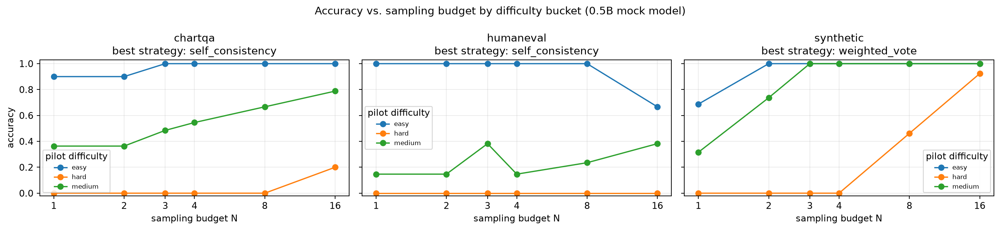
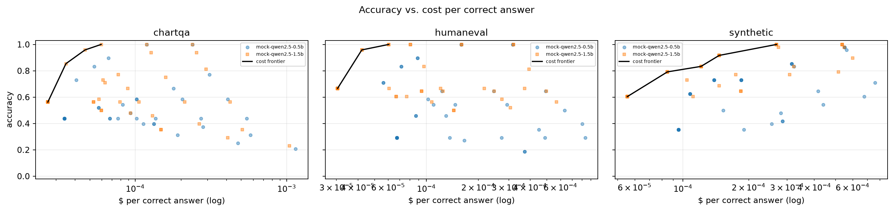
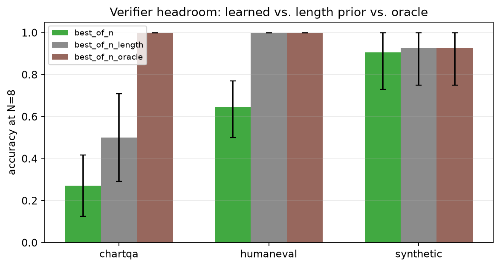
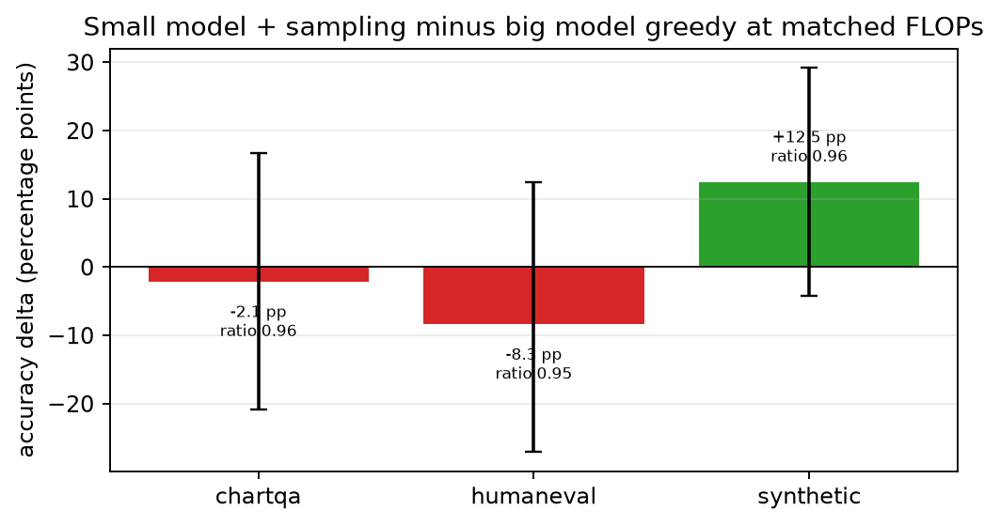

# ScaleTimeLLM

Inference-time scaling for reasoning and code generation with small open language models.

This repository measures how accuracy trades off against test-time compute — estimated FLOPs, generated
tokens, wall-clock latency and dollars per correct answer — across decoding strategies, model sizes,
tasks and difficulty buckets. It also asks whether the strategy that wins on text reasoning transfers
to chart/diagram question answering.

> **Backend disclosure.** The committed 666-cell sweep was produced by the deterministic **`MockLM` /
> synthetic backend**, not by Qwen weights. This was a deliberate CPU-only choice so the full suite
> finishes in minutes. Every sweep number below is copied from `results/summary.json`,
> `results/tables/` or `results/aggregate.csv`, and is labelled **synthetic**. The serving benchmark
> *does* use real `Qwen/Qwen2.5-0.5B-Instruct` weights through the Hugging Face backend on Apple MPS;
> that section is labelled separately. No number in this file was written by hand without a
> corresponding artifact.

## What it does

The project treats inference-time compute as a first-class experimental variable. A YAML config selects
a backend, one or more models, tasks, strategies, sampling budgets and seeds. The runner writes one
JSONL record per problem with exact token counts, estimated FLOPs, latency, cost and a strategy trace.
The analysis layer bootstraps confidence intervals, builds compute-optimal frontiers, compares a small
model with more sampling against a larger model with greedy decoding at matched FLOPs, and renders
tables and figures.

The three research questions are:

1. **Does test-time compute beat parameters at matched FLOPs?** In this build the direction is mixed and
   every task-level difference is a statistical tie: small-model sampling is `+12.5` points on synthetic
   math, `-8.3` points on code and `-2.1` points on chart QA versus larger-model greedy at a FLOP ratio
   of `0.95–0.96`.
2. **Where is the compute-optimal budget per difficulty bucket?** At each task's operating FLOPs cap the
   selected budgets are 1–4 samples for most buckets, with step search selected for the hard synthetic
   and chart buckets. Some hard code buckets have zero accuracy at the cap.
3. **Does the winning text strategy transfer to chart/diagram QA?** No. The best synthetic-reasoning
   strategy is verifier-weighted voting (`weighted_vote`, N=8, accuracy `0.927`), but on the chart
   stand-in it reaches `0.667` versus `0.802` for self-consistency. It beats greedy by `+16.7` points
   but loses `-13.5` points to the chart-specific winner.

## Architecture

```
configs/                     YAML experiments (smoke, full, serving)
scaletimellm/
  config.py                  typed dataclasses + strict YAML loader
  backends/
    base.py                  LMBackend ABC, Generation accounting
    mock.py                  deterministic synthetic LM simulator
    hf.py                    Transformers backend (seeded, batched)
    vllm_backend.py          optional lazy vLLM backend
    registry.py              factory with loud mock fallback
  tasks/
    synthetic.py             mixed-difficulty arithmetic
    gsm8k.py                 GSM8K loader + synthetic fallback
    humaneval.py             HumanEval + exec-graded synthetic fallback
    chartqa.py               ChartQA + synthetic chart stand-in
    sandbox.py               restricted subprocess code grader
    difficulty.py            cached k=4 pilot pass-rate buckets
  strategies/                greedy, self-consistency, best-of-N,
                             weighted vote, step search
  verifier/                  data generation, tiny transformer/TRL training,
                             scoring, AUROC/ECE/top-1 evaluation
  experiments/               single run, cached sweep, smoke pipeline
  analysis/                  bootstrap aggregation, compute-optimal,
                             multimodal transfer, plots, tables, report
  serving/bench.py           latency/throughput/memory benchmark
results/                     raw JSONL + aggregates + figures + tables + report
artifacts/verifier/          trained verifier checkpoints and data
paper/main.md                short preprint
```

Data flow:

```
YAML config
  -> backend (mock | HF | vLLM)
  -> task loader + grader
  -> strategy (budget N)
  -> per-problem JSONL (tokens, FLOPs, latency, cost, trace)
  -> bootstrap aggregation -> compute-optimal / plots / tables
  -> results/summary.json + results/REPORT.md
```

### Compute accounting

For a dense autoregressive model with `N` parameters, prompt length `P` and completion length `C`, the
repository uses the standard forward-pass approximation

```
FLOPs = 2 * N * (P + C)
```

This counts prefill and every generated token. It excludes the quadratic attention term, verifier
forward passes, and verifier training backwards passes. The exact strategy accounting sums token counts
from each backend `Generation`, and `utils/flops.py` documents the convention.

Dollar cost uses a documented per-million-token price constant of **$0.15/M input** and **$0.60/M
output**:

```
cost_usd = (P * 0.15 + C * 0.60) / 1_000_000
```

Cost per correct answer is computed at the cell level as

```
tokens_per_correct  = sum(total_tokens) / sum(correct)
dollars_per_correct = sum(cost_usd)     / sum(correct)
```

so it is the empirical expected token/dollar cost of obtaining one correct answer, not a per-attempt
average. If a cell has zero correct answers the value is undefined (`null` in JSON, `inf` internally).
Confidence intervals are non-parametric bootstrap percentile intervals with **2,000 resamples** over
the 48 problem-seed evaluations in each cell.

## How to run

### Install

```bash
# from the repository root
python3.11 -m venv .venv
source .venv/bin/activate
pip install -e ".[dev]"
# optional fast serving path (CUDA only):
pip install -e ".[vllm]"
# optional W&B logging:
pip install -e ".[logging]"
```

`python scripts/check_env.py` prints which backends are importable; add `--load` to download and load
the HF checkpoint.

### Smoke, full sweep, report

```bash
make smoke                  # ~3 s CPU; writes results/smoke/summary.json
make sweep                  # cached 666-cell mock sweep
make report                 # aggregate, compute-optimal, tables, figures, summary
make test                   # 43 tests + coverage report
make lint
```

To force a clean full sweep and reproduce the committed timing:

```bash
python -m scaletimellm.cli sweep --config configs/full.yaml --no-resume
```

The analysis is deterministic given raw files; `make report` reruns the aggregation and writes
`results/summary.json` and `results/REPORT.md`.

### Serving benchmark

```bash
HF_HOME=.hf_cache python -m scaletimellm.cli bench-serve \
  --config configs/serving.yaml --strategy self_consistency --budget 4 --n-problems 8
```

This tries vLLM only when `backend.name: vllm`; otherwise it uses the HF backend. The artifact records
the backend actually used, the device, percentiles, throughput and memory.

### Switch models and tasks

- `configs/base.yaml` — default HF path for `Qwen/Qwen2.5-0.5B-Instruct` with mock fallback.
- `configs/full.yaml` — the committed two-size mock sweep.
- `configs/serving.yaml` — real Qwen 0.5B HF serving check.
- Alternate Qwen/Granite names can be placed in `model.name` / `models[]`; `n_params` controls FLOPs.
- Task names: `synthetic`, `gsm8k`, `humaneval`, `chartqa`.
- `offline: true` (or `SCALETIMELLM_OFFLINE=1`) forces deterministic local stand-ins.

### W&B

W&B is **off by default**. Enable it either with `wandb: true` in YAML or with
`SCALETIMELLM_WANDB=1`; install the optional extra first. When disabled, no import or network call is
made and `WANDB_MODE` is set to `disabled`.

### Docker

```bash
docker build -t scaletimellm:smoke .
docker run --rm scaletimellm:smoke   # runs the CPU-only smoke sweep
```

The image was built and run successfully during this build. It installs CPU PyTorch and defaults to
`python -m scaletimellm.cli smoke`.

## Results

### Provenance and exact setup

| item | value | artifact |
|---|---|---|
| sweep backend | `mock` (synthetic=True) | `results/summary.json` |
| model stand-ins | `mock-qwen2.5-0.5b` (494,032,768 params), `mock-qwen2.5-1.5b` (1,540,000,000 params) | raw JSONL, `results/environment.json` |
| mock base accuracies | 0.42 (0.5B), 0.56 (1.5B) before difficulty adjustment | raw JSONL (`mock_accuracy`) |
| tasks | synthetic math, Humaneval synthetic fallback, ChartQA synthetic chart stand-in | raw JSONL (`task_source`) |
| slice | 16 problems per seed × 3 seeds (48 problem-seed evaluations per cell) | `results/summary.json` |
| cells / records | 666 / 10,656 | `results/sweep_run.json` |
| bootstrap | 2,000 resamples | `results/summary.json` |
| full no-resume sweep | 251.49 s on this machine | `results/sweep_run.json` |
| tests | 43 passed, 50.77% line coverage | `results/test_report.json` |
| Python / torch | 3.11.14 / 2.14.1 | `results/environment.json` |
| hardware | macOS 27.0.1, arm64, 8 CPUs, 16 GB | `results/serving_bench.json` |
| W&B | disabled | `results/environment.json` |

The mock backend is a simulator, not a pretrained model: it parses each synthetic prompt, draws a
seeded Bernoulli correctness outcome with a configurable probability, emits a chain-of-thought-style
completion with either the correct or a plausible incorrect answer, and counts tokens with a
deterministic whitespace/punctuation tokenizer. The large model therefore has both more parameters
(used by the FLOPs formula) and a higher simulated per-sample accuracy. See Limitations.

### Accuracy by strategy × budget × task

Per-model bootstrap accuracy and 95% CI. `N=3` is present in the full artifact but omitted here for
width; greedy is budget 1 only. Model names are simulator stand-ins.

#### Synthetic math (synthetic backend)

| model | strategy | N=1 | N=2 | N=4 | N=8 | N=16 |
|---|---|---|---|---|---|---|
| mock-qwen2.5-0.5b | greedy | 0.354 [0.229, 0.500] | — | — | — | — |
| mock-qwen2.5-0.5b | self_consistency | 0.354 [0.229, 0.500] | 0.354 [0.229, 0.500] | 0.479 [0.333, 0.625] | 0.646 [0.521, 0.771] | 0.708 [0.583, 0.833] |
| mock-qwen2.5-0.5b | best_of_n | 0.354 [0.229, 0.500] | 0.625 [0.479, 0.771] | 0.729 [0.604, 0.854] | 0.833 [0.729, 0.938] | 0.958 [0.896, 1.000] |
| mock-qwen2.5-0.5b | weighted_vote | 0.354 [0.229, 0.500] | 0.625 [0.479, 0.771] | 0.729 [0.604, 0.854] | 0.854 [0.750, 0.938] | 0.979 [0.938, 1.000] |
| mock-qwen2.5-0.5b | step_search | 0.354 [0.229, 0.500] | 0.500 [0.354, 0.646] | 0.417 [0.292, 0.542] | 0.542 [0.396, 0.688] | 0.604 [0.458, 0.750] |
| mock-qwen2.5-1.5b | greedy | 0.604 [0.458, 0.750] | — | — | — | — |
| mock-qwen2.5-1.5b | self_consistency | 0.604 [0.458, 0.750] | 0.604 [0.458, 0.750] | 0.771 [0.646, 0.896] | 0.833 [0.729, 0.938] | 0.896 [0.792, 0.979] |
| mock-qwen2.5-1.5b | best_of_n | 0.604 [0.458, 0.750] | 0.792 [0.667, 0.896] | 0.917 [0.833, 0.979] | 0.979 [0.938, 1.000] | 0.979 [0.938, 1.000] |
| mock-qwen2.5-1.5b | weighted_vote | 0.604 [0.458, 0.750] | 0.792 [0.667, 0.896] | 0.917 [0.833, 0.979] | 1.000 [1.000, 1.000] | 1.000 [1.000, 1.000] |
| mock-qwen2.5-1.5b | step_search | 0.604 [0.458, 0.750] | 0.729 [0.604, 0.854] | 0.646 [0.500, 0.771] | 0.771 [0.646, 0.875] | 0.792 [0.667, 0.896] |

#### Code generation (HumanEval synthetic fallback; sandboxed tests)

| model | strategy | N=1 | N=2 | N=4 | N=8 | N=16 |
|---|---|---|---|---|---|---|
| mock-qwen2.5-0.5b | greedy | 0.292 [0.167, 0.417] | — | — | — | — |
| mock-qwen2.5-0.5b | self_consistency | 0.292 [0.167, 0.417] | 0.292 [0.167, 0.417] | 0.292 [0.167, 0.417] | 0.354 [0.229, 0.479] | 0.396 [0.271, 0.542] |
| mock-qwen2.5-0.5b | best_of_n | 0.292 [0.167, 0.417] | 0.458 [0.312, 0.604] | 0.646 [0.500, 0.771] | 0.646 [0.500, 0.771] | 0.646 [0.500, 0.771] |
| mock-qwen2.5-0.5b | weighted_vote | 0.292 [0.167, 0.417] | 0.458 [0.312, 0.604] | 0.542 [0.396, 0.688] | 0.542 [0.396, 0.688] | 0.500 [0.354, 0.646] |
| mock-qwen2.5-0.5b | step_search | 0.292 [0.167, 0.417] | 0.271 [0.146, 0.396] | 0.188 [0.083, 0.292] | 0.292 [0.167, 0.417] | 0.292 [0.167, 0.417] |
| mock-qwen2.5-1.5b | greedy | 0.667 [0.542, 0.792] | — | — | — | — |
| mock-qwen2.5-1.5b | self_consistency | 0.667 [0.542, 0.792] | 0.667 [0.542, 0.792] | 0.833 [0.729, 0.938] | 0.583 [0.438, 0.708] | 0.812 [0.688, 0.917] |
| mock-qwen2.5-1.5b | best_of_n | 0.667 [0.542, 0.792] | 0.604 [0.458, 0.729] | 0.646 [0.500, 0.771] | 0.646 [0.500, 0.771] | 0.646 [0.500, 0.771] |
| mock-qwen2.5-1.5b | weighted_vote | 0.667 [0.542, 0.792] | 0.604 [0.458, 0.729] | 0.667 [0.521, 0.792] | 0.521 [0.375, 0.667] | 0.562 [0.417, 0.708] |
| mock-qwen2.5-1.5b | step_search | 0.667 [0.542, 0.792] | 0.604 [0.458, 0.750] | 0.500 [0.354, 0.625] | 0.667 [0.542, 0.812] | 0.667 [0.542, 0.812] |

#### Chart QA (synthetic chart stand-in)

| model | strategy | N=1 | N=2 | N=4 | N=8 | N=16 |
|---|---|---|---|---|---|---|
| mock-qwen2.5-0.5b | greedy | 0.438 [0.292, 0.583] | — | — | — | — |
| mock-qwen2.5-0.5b | self_consistency | 0.438 [0.292, 0.583] | 0.438 [0.292, 0.583] | 0.583 [0.438, 0.729] | 0.667 [0.521, 0.792] | 0.771 [0.646, 0.875] |
| mock-qwen2.5-0.5b | best_of_n | 0.438 [0.292, 0.583] | 0.521 [0.375, 0.646] | 0.312 [0.188, 0.438] | 0.250 [0.125, 0.375] | 0.208 [0.104, 0.313] |
| mock-qwen2.5-0.5b | weighted_vote | 0.438 [0.292, 0.583] | 0.521 [0.375, 0.646] | 0.583 [0.438, 0.729] | 0.583 [0.438, 0.729] | 0.583 [0.458, 0.708] |
| mock-qwen2.5-0.5b | step_search | 0.438 [0.292, 0.583] | 0.438 [0.292, 0.583] | 0.396 [0.250, 0.542] | 0.375 [0.250, 0.521] | 0.312 [0.188, 0.438] |
| mock-qwen2.5-1.5b | greedy | 0.562 [0.417, 0.708] | — | — | — | — |
| mock-qwen2.5-1.5b | self_consistency | 0.562 [0.417, 0.708] | 0.562 [0.417, 0.708] | 0.771 [0.646, 0.875] | 0.938 [0.854, 1.000] | 0.938 [0.854, 1.000] |
| mock-qwen2.5-1.5b | best_of_n | 0.562 [0.417, 0.708] | 0.500 [0.375, 0.625] | 0.458 [0.312, 0.584] | 0.292 [0.167, 0.417] | 0.229 [0.125, 0.354] |
| mock-qwen2.5-1.5b | weighted_vote | 0.562 [0.417, 0.708] | 0.500 [0.375, 0.625] | 0.667 [0.521, 0.792] | 0.750 [0.625, 0.875] | 0.812 [0.688, 0.917] |
| mock-qwen2.5-1.5b | step_search | 0.562 [0.417, 0.708] | 0.583 [0.458, 0.729] | 0.354 [0.229, 0.500] | 0.396 [0.250, 0.521] | 0.354 [0.229, 0.479] |

The complete per-cell grid, including N=3, oracle and length-prior ablations, is in
[`results/tables/headline_grid.md`](results/tables/headline_grid.md).

### Headline winners

| task | model | strategy | N | accuracy (95% CI) | tokens / correct | $ / correct |
|---|---|---|---|---|---|---|
| synthetic | mock-qwen2.5-1.5b | weighted_vote | 8 | 1.000 [1.000, 1.000] | 695.5 | $0.0002688 |
| humaneval | mock-qwen2.5-1.5b | self_consistency | 4 | 0.833 [0.729, 0.938] | 297.1 | $0.0000968 |
| chartqa | mock-qwen2.5-1.5b | self_consistency | 8 | 0.938 [0.854, 1.000] | 565.3 | $0.0001270 |

These are the highest-accuracy main-strategy cells per task (oracle and length-prior ablations
excluded). Note that they are not always the cheapest point on the frontier.

### Compute-optimal budget per difficulty bucket

Selected at each task's operating FLOPs cap (chart `4.51e11`, code `4.20e11`, synthetic `5.95e11`).

| task | difficulty | model | strategy | N | accuracy | mean FLOPs | n |
|---|---|---|---|---|---|---|---|
| chartqa | easy | mock-qwen2.5-0.5b | best_of_n | 2 | 1.000 | 1.308e11 | 10 |
| chartqa | hard | mock-qwen2.5-0.5b | step_search | 3 | 0.600 | 2.476e11 | 5 |
| chartqa | medium | mock-qwen2.5-0.5b | weighted_vote | 4 | 0.576 | 2.619e11 | 33 |
| humaneval | easy | mock-qwen2.5-0.5b | best_of_n | 1 | 1.000 | 6.357e10 | 9 |
| humaneval | hard | mock-qwen2.5-0.5b | best_of_n | 1 | 0.000 | 5.928e10 | 5 |
| humaneval | medium | mock-qwen2.5-1.5b | best_of_n | 1 | 0.909 | 1.971e11 | 22 |
| synthetic | easy | mock-qwen2.5-0.5b | best_of_n | 2 | 1.000 | 1.664e11 | 16 |
| synthetic | hard | mock-qwen2.5-0.5b | step_search | 2 | 0.308 | 2.422e11 | 13 |
| synthetic | medium | mock-qwen2.5-0.5b | best_of_n | 3 | 1.000 | 2.572e11 | 19 |

### Equal-FLOPs: small model + sampling vs. larger model + greedy

N=3 gives a FLOP ratio of 0.95–0.96 versus the 1.5B greedy point.

| task | small config | small accuracy | big greedy | FLOP ratio | Δ accuracy (95% CI) | verdict |
|---|---|---|---|---|---|---|
| chartqa | self_consistency N=3 | 0.542 | 0.562 | 0.96 | -0.021 [-0.208, +0.167] | statistical tie |
| humaneval | best_of_n N=3 | 0.583 | 0.667 | 0.95 | -0.083 [-0.271, +0.125] | statistical tie |
| synthetic | best_of_n N=3 | 0.729 | 0.604 | 0.96 | +0.125 [-0.042, +0.292] | statistical tie |

The point estimates favour sampling for synthetic math and greedy for code/chart, but all paired
bootstrap intervals cross zero. The data do not support a universal “more test-time compute beats more
parameters” claim at this sample size.

### Verifier training and headroom

Trained on 560 mock math solutions (140 problems × 4 samples); evaluated on 180 held-out solutions
(45 problems × 4 samples). Outcome labels come from the task grader. The custom verifier is a 1-layer
byte-level transformer encoder; the pairwise TRL variant uses `trl.RewardTrainer` on chosen/rejected
pairs.

| objective | AUROC | accuracy | ECE | top-1 selection | random selection |
|---|---|---|---|---|---|
| outcome (BCE) | 0.9952 | 0.9833 | 0.0160 | 0.8667 | 0.5111 |
| pairwise (custom margin) | 0.9969 | 0.5111 | 0.3604 | 0.8667 | 0.5111 |
| pairwise (TRL RewardTrainer) | 1.0000 | 0.8722 | 0.3671 | 0.8889 | 0.5111 |

At N=8 the learned outcome verifier has large headroom on code and chart, and it does not improve over
the length-prior baseline there:

| task | learned | length prior | oracle | oracle − learned |
|---|---|---|---|---|
| chartqa | 0.271 | 0.500 | 1.000 | +0.729 |
| humaneval | 0.646 | 1.000 | 1.000 | +0.354 |
| synthetic | 0.906 | 0.927 | 0.927 | +0.021 |

The near-perfect AUROC is partly a simulator artefact: incorrect mock completions contain a
self-doubt phrase, which the tiny verifier can learn. The transfer failure is therefore the more
credible signal from this experiment.

### Cost per correct answer

| task | model | strategy | N | tokens / correct | $ / correct |
|---|---|---|---|---|---|
| synthetic | mock-qwen2.5-1.5b | weighted_vote | 8 | 695.5 | $0.0002688 |
| humaneval | mock-qwen2.5-1.5b | self_consistency | 4 | 297.1 | $0.0000968 |
| chartqa | mock-qwen2.5-1.5b | self_consistency | 8 | 565.3 | $0.0001270 |

Costs rise quickly with N on tasks where extra samples do not add unique correct answers; the Pareto
frontier is in `results/figures/pareto_frontier.png`.

### Real HF serving benchmark

This section uses actual `Qwen/Qwen2.5-0.5B-Instruct` weights, not the mock.

| backend | model | device | strategy | N | problems | p50 latency | p95 latency | completion tok/s | problems/s | peak RSS |
|---|---|---|---|---|---|---|---|---|---|---|
| hf | Qwen/Qwen2.5-0.5B-Instruct | mps | self_consistency | 4 | 8 | 1.152 s | 1.871 s | 96.92 | 0.757 | 271.2 MB |

Model load took 2.74 s; vLLM was not installed, so the HF fallback was used and recorded. All 32
samples hit the 32-token cap, so this is a latency/throughput measurement rather than a quality result
(accuracy on the eight mock-style prompts was 0.25).

### Multimodal transfer

The winning synthetic-reasoning strategy (`weighted_vote`, N=8, accuracy 0.927 [0.750, 1.000]) was
applied to the chart stand-in:

| chart metric | value |
|---|---|
| same strategy accuracy | 0.667 [0.438, 0.875] |
| chart-best strategy (self_consistency, N=8) | 0.802 [0.521, 1.000] |
| greedy chart baseline | 0.500 [0.292, 0.708] |
| transfer vs greedy | +0.167 |
| transfer vs chart-best | -0.135 |
| retention (chart / source) | 0.719 |

The strategy transfers above greedy but is not the best chart strategy; self-consistency wins. This is
a negative answer to the transfer question for verifier-weighted voting.

### Figures











## Limitations and next steps

- **The main sweep is synthetic.** MockLM is a simulator with controlled accuracy and token costs, not
  a pretrained Qwen model. The reported accuracies, FLOPs and costs characterise the pipeline and the
  simulator, not Qwen2.5. The real HF serving check is separate and small.
- **Task stand-ins.** The committed sweep uses synthetic arithmetic, synthetic coding problems with the
  real sandboxed unit-test grader, and a tabular chart stand-in. GSM8K, HumanEval and ChartQA loaders
  exist and fall back offline, but real model evaluations on those datasets require downloading weights
  and a larger compute budget.
- **Verifier leakage.** The mock’s incorrect completions contain a self-doubt phrase, which inflates
  AUROC. The learned verifier also fails to transfer to code/chart, where the length prior is stronger.
- **Small samples.** Each cell has 48 problem-seed evaluations. CIs are wide; many headline differences
  are not significant.
- **FLOPs are approximate.** The `2N(P+C)` convention ignores attention quadratic cost, verifier
  compute and training. Prices are fixed constants, not provider quotes.
- **Serving.** Only eight Qwen prompts were benchmarked, on Apple MPS, with a 32-token cap; vLLM was
  unavailable. The p95 estimate is based on eight per-problem latencies.
- **Security.** The code sandbox is a best-effort subprocess with restricted imports and limits; it is
  not a hardened container for untrusted code.

Next steps: run the full grid against real Qwen2.5-0.5B/1.5B checkpoints on a GPU, train the verifier
on real outcome data without simulator-specific cues, evaluate real GSM8K/HumanEval/ChartQA slices, and
add a stronger multimodal VLM path.

## Reproducibility

```bash
# exact environment used for the committed artifacts
python3.11 -m venv .venv
source .venv/bin/activate
pip install -e ".[dev]"
python scripts/write_environment.py

# verifier
bash scripts/train_verifier.sh

# full 666-cell sweep (deterministic mock backend; ~4 min here)
python -m scaletimellm.cli sweep --config configs/full.yaml --no-resume

# HF serving benchmark (downloads Qwen 0.5B)
HF_HOME=.hf_cache python -m scaletimellm.cli bench-serve --config configs/serving.yaml

# analysis, tables, figures, summary and report
python -m scaletimellm.cli report

# verification
make lint
make test
```

Seeds are fixed in `configs/full.yaml` (`0,1,2`) and in every task/strategy/verifier path. The mock
backend is seeded by `sha256(seed, sample index, prompt, parameter count)`. Raw cell JSONL files double
as the sweep cache; `--no-resume` regenerates them. Exact package versions are recorded in
`results/environment.json`; test count and coverage are recorded in `results/test_report.json`.

## License

MIT. See [LICENSE](LICENSE). Contributions follow [CONTRIBUTING.md](CONTRIBUTING.md).
